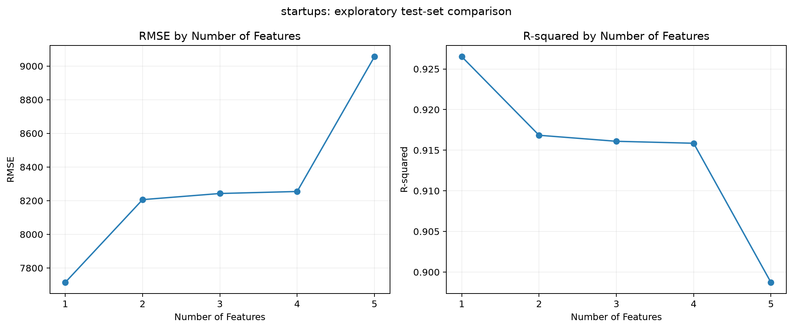
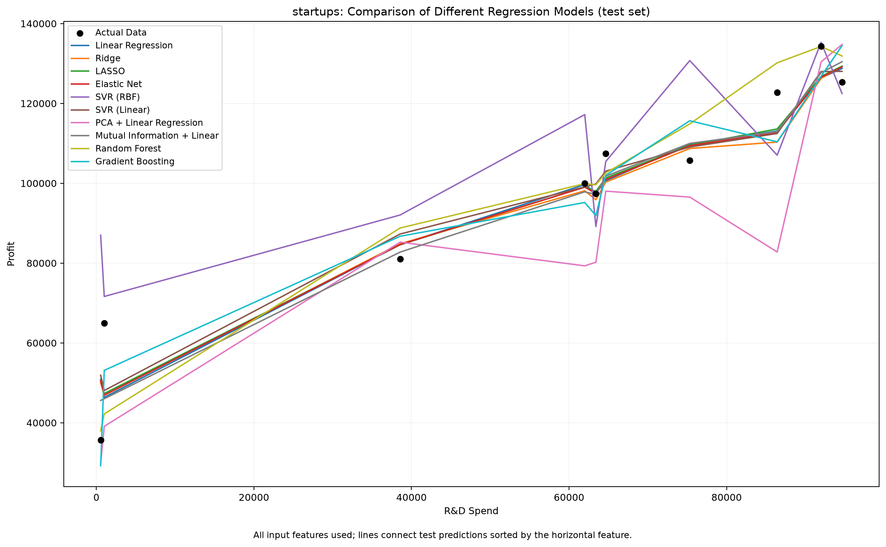
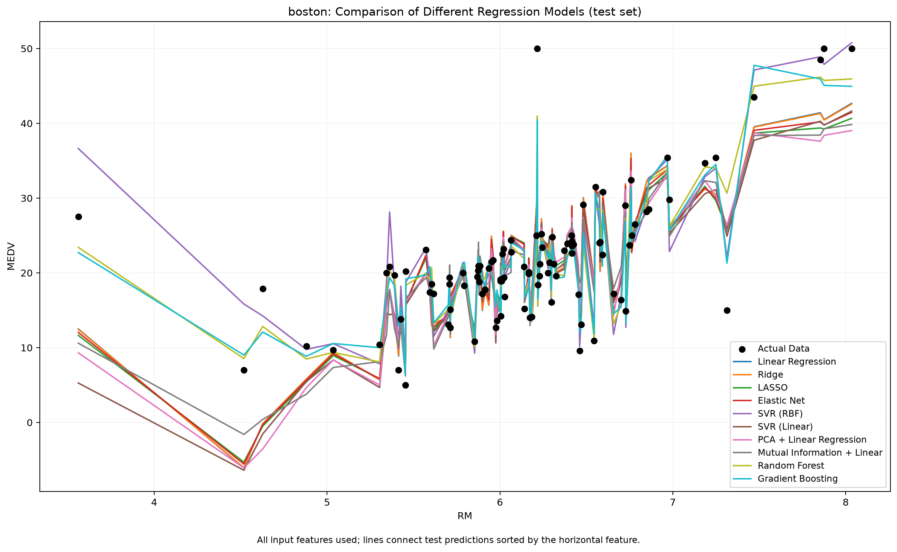

# DIC2：50 Startups 與 Boston Housing 迴歸分析

以 CRISP-DM 六階段分別分析兩個資料集，包含多元線性迴歸、特徵數量比較、十種模型配置比較，以及互動網頁報告。

**線上網站：[開啟 Regression Explorer](https://ryanyeh57.github.io/DIC2-50-startup-and-boston-housing/)**

## 網頁與圖表預覽

網站可切換資料集與特徵數量、查看迴歸係數、即時試算線性模型預測、開關模型預測線，以及下載分析結果。也可直接用瀏覽器開啟 `docs/index.html`；不需要 Python 伺服器或外部圖表 CDN。

以下為程式實際產生的圖表預覽，並非網頁畫面截圖。

### 50 Startups：特徵數量與模型比較





### Boston Housing：模型比較



## 資料集

兩個資料集獨立訓練與評估，不合併資料。

| 資料集 | 檔案 | 筆數 | 輸入欄位 | 預測目標 |
| --- | --- | --- | --- | --- |
| 50 Startups | `50_Startups.csv` | 50 | R&D Spend、Administration、Marketing Spend、State | Profit |
| Boston Housing | `BostonHousing.csv` | 506 | CRIM、ZN、INDUS、CHAS、NOX、RM、AGE、DIS、RAD、TAX、PTRATIO、B、LSTAT | MEDV |

CSV 已包含於倉庫，須保留標題列。程式會處理欄位名稱大小寫與前後空白；數值欄位須可轉為數值。下載來源記錄於 [DATA_SOURCES.md](DATA_SOURCES.md)，環境與功能需求見 [requirements.md](requirements.md)。Boston Housing 為歷史教學資料；使用前應確認來源、欄位單位與使用限制。

## 安裝與執行

以下指令在專案根目錄的 PowerShell 執行。已使用 Python 3.14.3 執行並驗證兩份資料；套件需求列於 [requirements.txt](requirements.txt)。

```powershell
python -m venv .venv
.\.venv\Scripts\python.exe -m pip install -r requirements.txt
.\.venv\Scripts\python.exe main.py
```

同時開啟 Matplotlib 圖表視窗：

```powershell
.\.venv\Scripts\python.exe main.py --show
```

關閉所有圖表視窗後程式結束；PNG 同時保存至 `outputs/`。

只分析單一資料集，或指定不同的 CSV 路徑：

```powershell
.\.venv\Scripts\python.exe main.py --dataset startups
.\.venv\Scripts\python.exe main.py --dataset boston
.\.venv\Scripts\python.exe main.py --startups "路徑\50_Startups.csv" --boston "路徑\BostonHousing.csv"
```

可用 `--output` 指定分析輸出資料夾；網頁匯出程式目前讀取預設的 `outputs/`，因此更新網頁時請使用預設輸出位置。

## CRISP-DM 分析流程

| 階段 | 實作 |
| --- | --- |
| 商業理解 | 分別定義 Profit 與 MEDV 預測目標，以測試 RMSE 低於平均值基準作為探索性成功標準 |
| 資料理解 | 驗證必要欄位，記錄缺失值、重複紀錄與資料摘要 |
| 資料準備 | 移除完全重複紀錄及缺失目標；固定種子 42，切分 80% 訓練與 20% 測試資料；填補缺失值及 One-Hot 編碼 |
| 建模 | 全特徵線性迴歸 Pipeline、五折訓練集交叉驗證、特徵數量探索，以及十種模型配置比較 |
| 評估 | 計算 R²、MAE、RMSE；模型比較另輸出 MSE；產出預測、殘差圖與基準比較 |
| 部署 | 保存完整線性模型 Pipeline，重新載入並驗證預測一致，匯出互動網頁至 GitHub Pages |

前處理僅使用訓練資料擬合；交叉驗證每折重新擬合完整 Pipeline。網頁即時預測使用所選特徵數的線性模型係數，在瀏覽器計算，不會重新訓練。

## 評估結果

下表為目前匯出的全特徵線性迴歸模型結果，並非十種模型比較中的最佳分數。

| 資料集 | 訓練／測試筆數 | Test R² | Test MAE | Test RMSE | 平均值基準 RMSE |
| --- | --- | --- | --- | --- | --- |
| 50 Startups | 40／10 | 0.8987 | 6,961.48 | 9,055.96 | 33,776.69 |
| Boston Housing | 404／102 | 0.6688 | 3.1891 | 4.9286 | 8.6629 |

MAE 與 RMSE 使用各資料集目標的原始單位，不宜直接跨資料集比較。

### 特徵數量比較

網頁可切換五種特徵選取方法，也可用 **Compare All 5 Methods** 同時比較曲線與指定特徵數的結果。每種方法皆只使用訓練資料選取特徵，再重新擬合 OLS；方法、特徵數、係數與即時預測會連動更新。比較全部時顯示五方法結果表，係數與預測則在單一方法模式使用。

| 方法 | 選取方式 |
| --- | --- |
| Lasso | 標準化輸入與目標，按 L1 係數絕對值排序，alpha=0.01 |
| Forward SFS | 每次加入使五折訓練集 CV MSE 最小的特徵 |
| RFE | 以標準化線性迴歸係數反覆移除特徵 |
| ElasticNet | 按正則化係數絕對值排序，alpha=0.01、l1_ratio=0.5 |
| Exhaustive Search | 枚舉每個特徵數的全部組合，以五折訓練集 CV MSE 選取 |

Lasso／ElasticNet 係數為零或同分時，以訓練資料 F 分數排序。兩者用於特徵排序，網頁係數與即時預測使用選取後重新擬合的 OLS，而非正則化模型。

50 Startups 共五個編碼後特徵；Boston Housing 共十三個，精確窮舉 8,191 個非空組合。程式將 Exhaustive Search 限制於最多十三個編碼後特徵。既有 `feature_comparison.csv` 與圖表保留 F 分數排序結果；網頁五種方法使用新輸出的 `feature_methods.csv`。

Training CV RMSE 為已選定特徵組合的分數；搜尋後可能偏樂觀，並非巢狀交叉驗證的無偏評估。

測試集曲線為探索性比較，不用來選擇正式模型的特徵數，也不能單憑曲線認定過度擬合。保存的模型仍使用全部指定特徵。

### 十種模型配置

Linear Regression、Ridge、LASSO、Elastic Net、SVR（RBF）、SVR（Linear）、PCA + Linear Regression、Mutual Information + Linear Regression、Random Forest、Gradient Boosting。

模型比較使用相同訓練／測試切分；輸入與目標標準化僅在訓練資料擬合，預測與指標轉回原始目標單位。PCA 和 Mutual Information 分別搭配線性迴歸，並非獨立的迴歸演算法。

比較圖以 R&D Spend（50 Startups）或 RM（Boston Housing）作橫軸，連接排序後的測試預測。模型以全部輸入欄位為起點，PCA／Mutual Information 配置另做轉換或選取；圖中的折線不是單一變數反應曲線。

測試 MSE 排序僅描述本次實驗；各模型使用固定配置，未做系統性調參。部署保存的模型為全特徵線性迴歸。

## 輸出檔案

分析結果分別存於 `outputs/startups/` 與 `outputs/boston/`。

| 檔案 | 用途 |
| --- | --- |
| `report.json` | 資料品質、評估結果、基準比較及網頁試算所需的模型係數 |
| `data_summary.csv`、`coefficients.csv` | 資料摘要與全特徵模型係數 |
| `test_predictions.csv`、`regression_diagnostics.png` | 測試預測、殘差與診斷圖 |
| `feature_comparison.csv`、`feature_comparison_table.png`、`feature_performance.png` | 特徵數量比較表與折線圖 |
| `feature_methods.csv` | 五種選取方法在每個特徵數下的所選特徵、訓練 CV RMSE 與測試指標 |
| `model_comparison.csv`、`model_comparison_table.png`、`model_comparison.png` | 多模型評估表與預測比較圖 |
| `model_comparison_predictions.csv` | 各比較模型的逐筆測試預測 |
| `model.joblib`、`prediction_input.csv` | 完整線性模型 Pipeline 與一列輸入示例 |

`outputs/`、虛擬環境與模型檔不納入 Git；網站所需的圖片、CSV 與報告副本放在 `docs/assets/`。

## 更新網站

修改分析程式或資料後，重新執行兩個資料集並匯出：

```powershell
.\.venv\Scripts\python.exe main.py
.\.venv\Scripts\python.exe export_site.py
```

匯出程式從追蹤中的 `docs/` 複製版面至 `site/dist/`，更新分析資料，再同步回 GitHub Pages 使用的 `docs/`。`site/` 是忽略追蹤的本機工作目錄。

如需修改版面，請編輯 `docs/index.html`、`docs/styles.css` 與 `docs/app.js`，再執行匯出。`docs/` 為版面來源，避免被舊的本機 Sites 檔案覆蓋。

確認網頁後提交並推送：

```powershell
git add main.py feature_selection.py export_site.py docs README.md requirements.md
git commit -m "Update regression report website"
git push origin main
```

GitHub Pages 已設定為從 `main` 分支的 `/docs` 發布。後續推送網頁變更會觸發部署；可在倉庫的 [Actions](https://github.com/RyanYeh57/DIC2-50-startup-and-boston-housing/actions) 查看結果。請勿將本機 `site/` 作為子模組加入倉庫。

## 載入已保存模型

只載入自己產生或可信來源的模型。

```python
import joblib
import pandas as pd

model = joblib.load('outputs/startups/model.joblib')
rows = pd.read_csv('outputs/startups/prediction_input.csv')
print(model.predict(rows))
```

## 分析限制

固定種子的單次切分不能保證泛化能力；特徵係數不代表因果關係。正式用途仍需定義業務可接受的誤差門檻、審核資料來源、解讀實際結果，並規劃模型監控與更新。

網頁版面與互動概念參考：[Multiple Linear Regression Explorer](https://huanchen1107.github.io/AIoT-DIC2-MultipleLR/)。本專案的圖表與數值來自自己的分析流程。

